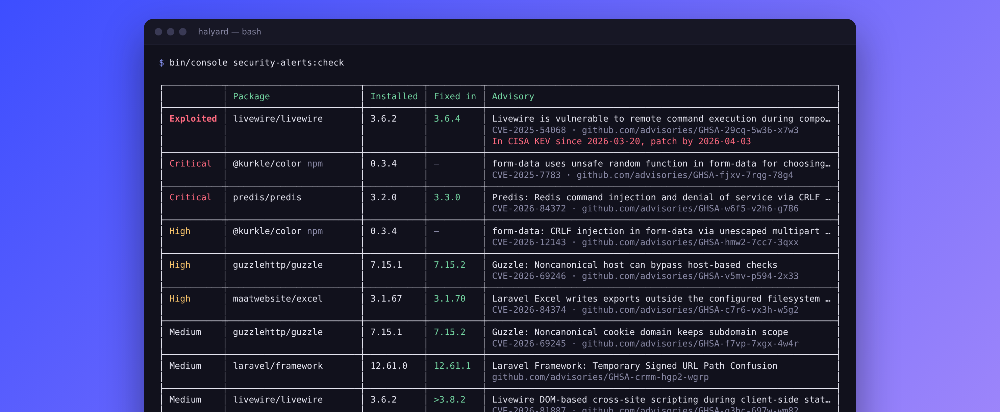
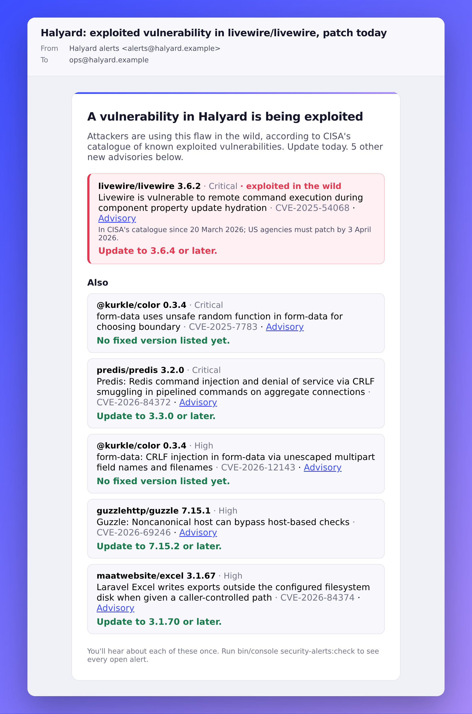

<p align="center">
  <a href="https://github.com/Ruvelo/symfony-security-alerts/actions/workflows/tests.yml"></a>
  
  
  
  <a href="LICENSE"></a>
</p>

# Security Alerts Bundle for Symfony

**Know when a dependency turns dangerous.** `composer audit` only runs when someone types it. This bundle checks the exact Composer and npm versions your app runs every day, tells you once when one becomes vulnerable, and again when attackers start exploiting it in the wild.

```
composer require ruvelo/security-alerts-bundle
```

Then tell it who to email (see [the recipe](#installation-and-the-flex-recipe)) and try `bin/console security-alerts:check`. The scanning is done by [`ruvelo/security-advisories`](https://github.com/Ruvelo/security-advisories), the framework-agnostic core shared with the [Laravel](https://github.com/Ruvelo/laravel-security-alerts) and [Magento 2](https://github.com/Ruvelo/magento2-security-alerts) versions; this bundle wires it into Symfony.

## A quick tour



**In your terminal and in CI.** `bin/console security-alerts:check` lists what is vulnerable, exploited flaws first, with the version that fixes each. `--fail-on=exploited` fails a pipeline, `--json` feeds anything else.



**One email for everything new**, exploited first, through your own mailer or Notifier. Never the same alert twice.

## Features

- **Composer and npm**: exact versions from `composer.lock` and, if you have one, `package-lock.json` (lockfile versions 1 to 3). Missing files are fine.
- **Exploited in the wild first**: CVEs in CISA's [known exploited vulnerabilities](https://www.cisa.gov/known-exploited-vulnerabilities-catalog) catalogue are marked, with the date added and the due date, and ranked above everything else.
- **What to update to**: the fixed version is worked out from the advisory's ranges, including ranges split by minor version. When an advisory only names the last affected release, it says so (`>2.10.1`).
- **Quiet**: each finding is announced once, and once more if it becomes exploited. Fixed ones are closed when the package is updated. A failed feed never closes anything, and `cache:clear` never re-sends (see [How it remembers](#how-it-remembers)).
- **Symfony Notifier or plain Mailer**: email and any chat channel your app has set up (Slack, Teams, Discord...), or just the Mailer if you don't use Notifier. Plus events for everything else.
- **Scheduled for you** with `symfony/scheduler`, or one cron line.
- **CI-ready command**: `--fail-on=exploited|critical|high|medium|any`, `--json`, exit code 2 when it couldn't check everything.
- **Free sources, no keys**: Packagist, OSV.dev and CISA. Only package names (and, for npm, versions) leave your server, as with `composer audit`.
- **A profiler panel** in dev, with the latest report.

Watching many sites? [Valtry](https://valtry.co.uk/?utm_source=ruvelo&utm_medium=github&utm_campaign=symfony-security-alerts) scans them from the outside.

## Requirements

- PHP 8.2+
- Symfony 6.4 or 7.x (FrameworkBundle, HttpClient, Cache, Console)
- Optional: `symfony/notifier` or `symfony/mailer` to send alerts, `symfony/scheduler` (with `symfony/messenger`) to schedule them, `symfony/web-profiler-bundle` for the panel, `doctrine/dbal` to keep state in a table

## Installation and the Flex recipe

`composer require` registers the bundle if you use Flex. Without it, add it to `config/bundles.php`:

```php
Ruvelo\SecurityAlertsBundle\SecurityAlertsBundle::class => ['all' => true],
```

The bundle works with no configuration, but nobody is told until you set recipients. This is what a Flex recipe for it would contain (no recipe repository is needed to use the bundle: add these by hand):

`config/packages/security_alerts.yaml`

```yaml
security_alerts:
    notify:
        recipients: ['%env(SECURITY_ALERTS_MAIL)%']   # a comma-separated list works too
        from: 'alerts@example.com'
```

`.env`

```
###> ruvelo/security-alerts-bundle ###
SECURITY_ALERTS_MAIL=you@example.com
###< ruvelo/security-alerts-bundle ###
```

`.gitignore` gets `/var/security_alerts/` only if your `.gitignore` doesn't already ignore `/var/`, which the Symfony skeleton does.

Email needs a mailer: `framework.mailer.dsn` (or `envelope.sender` instead of `notify.from`). Then run `bin/console security-alerts:check --notify` once to see it work.

## Where it looks, and what it sends

| Source | For | What leaves your server |
|---|---|---|
| [Packagist security advisories](https://packagist.org/apidoc#list-security-advisories) | Composer packages. It's the API `composer audit` uses, fed by the GitHub Advisory Database and FriendsOfPHP | Package names, in a POST of up to 200 at a time |
| [OSV.dev](https://osv.dev) | npm packages from `package-lock.json` | Package names and versions; then each matching advisory is fetched by its ID |
| [CISA KEV](https://www.cisa.gov/known-exploited-vulnerabilities-catalog) | Which CVEs are being exploited | Nothing: the catalogue is downloaded whole |

Nothing about your app is sent: no URL, no environment, no code. Requests go through Symfony's `http_client` (so they show in its profiler panel and obey your proxy settings) and identify themselves as `ruvelo/security-advisories`. Answers are cached in `cache.app` (an hour for advisories, six hours for the catalogue); `--fresh` skips the cache.

## The command

```
bin/console security-alerts:check
```

| Option | |
|---|---|
| `--fail-on=exploited` | Exit with 1 when a finding is at least this bad: `exploited`, `critical`, `high`, `medium` or `any`. Exploited findings count at every level |
| `--json` | Print the report as JSON |
| `--notify` | Remember findings, send alerts for new ones and fire events. This is what the schedule runs; without it, the command changes nothing |
| `--fresh` | Ignore cached feeds |

Exit codes: `0` fine, `1` a finding reached `--fail-on` (or the option was invalid), `2` a lockfile or feed couldn't be read, or an alert couldn't be sent, so the answer is incomplete.

In GitHub Actions, after `composer install`:

```yaml
- run: bin/console security-alerts:check --fail-on=exploited
```

## Scheduling

With [`symfony/scheduler`](https://symfony.com/doc/current/scheduler.html) and `symfony/messenger` installed, the bundle registers a daily schedule (07:00) named `security_alerts`. Run its worker like any other:

```
bin/console messenger:consume scheduler_security_alerts
```

If you already run a worker for your own schedule, add the message to it instead and turn the bundle's off with `schedule.enabled: false`:

```php
#[AsSchedule('default')]
final class MainSchedule implements ScheduleProviderInterface
{
    public function getSchedule(): Schedule
    {
        return (new Schedule())->add(SecurityAlertsSchedule::message('07:00'));
    }
}
```

Without the scheduler, use cron:

```
0 7 * * * cd /var/www/app && bin/console security-alerts:check --notify --env=prod
```

## How it remembers

To announce only what is new, the bundle keeps the set of findings it has seen. By default that is **a dedicated filesystem cache pool in `var/security_alerts`**, outside the kernel cache, so `cache:clear` and deploys that recreate `var/cache` don't make it forget. It does need `var/` to survive between runs, which it does on a normal server but not on ephemeral filesystems (containers, some PaaS). There:

```yaml
security_alerts:
    state:
        store: pool
        pool: app.persistent_pool    # a pool backed by Redis, a database or a mounted volume
        # or:
        # store: doctrine            # a small table, created on first use (needs doctrine/dbal)
        # connection: doctrine.dbal.default_connection
```

If you point `state.pool` at a pool that is cleared (such as `cache.app`), a `cache:pool:clear` will make the next check announce everything again. That's the only cost: nothing is lost, you get one repeat email.

With `store: doctrine`, tell Doctrine to leave the table alone, or a migration diff will want to drop it: `doctrine.dbal.schema_filter: '~^(?!security_alerts_state$)~'`.

A finding is one advisory on one package. It's **new** the first time a check sees it, or if it comes back after being fixed. It's **exploited** the first time the check sees its CVE in CISA's catalogue. It's **resolved** when a complete check of its ecosystem no longer finds it. An alert that couldn't be sent (mail down) isn't recorded, so the next check tries again. With nobody to tell (no recipients, no chat channel), findings are recorded and events still fire, and the command says so.

## Notifications

If `symfony/notifier` is configured (`framework.notifier`), alerts go through it; otherwise through the Mailer. Either way the email is the same, written without Twig.

```yaml
framework:
    notifier:
        chatter_transports:
            slack: '%env(SLACK_DSN)%'

security_alerts:
    notify:
        recipients: ['%env(SECURITY_ALERTS_MAIL)%']
        channels: [email, chat]     # or chat/slack to pick the transport
```

Email goes to the recipients, one message each. Every other channel gets one message, with the same text, through the transport you configured. `channels` defaults to `[email]`.

## Configuration

Everything works without configuration. The full tree, with defaults (`bin/console config:dump-reference security_alerts` prints it too):

```yaml
security_alerts:
    enabled: true                   # false registers nothing
    include_dev: false              # dev packages aren't deployed, so they're left out
    project_dir: '%kernel.project_dir%'   # where composer.lock and package-lock.json are
    cache_pool: cache.app           # for the feeds; null fetches every time
    cache_ttl: { advisories: 3600, kev: 21600, osv_details: 604800 }
    http: { client: http_client, timeout: 15, tries: 2 }
    state:
        store: filesystem           # filesystem | pool | doctrine
        directory: '%kernel.project_dir%/var/security_alerts'
        pool: null
        connection: doctrine.dbal.default_connection
        table: security_alerts_state
    notify:
        recipients: []
        channels: [email]
        from: null                  # your mailer's envelope sender when null
        app_name: null              # the project directory name when null
        min_severity: null          # skip new findings below critical | high | medium | low. Exploited ones are always sent
    schedule:
        enabled: true
        time: '07:00'
        timezone: null              # the PHP default
        name: security_alerts
```

## Events

| Event | Fires when | Has |
|---|---|---|
| `VulnerabilityFoundEvent` | A check sees a finding for the first time, or again after it was fixed | `$finding` |
| `VulnerabilityExploitedEvent` | A finding's CVE is in CISA's catalogue for the first time, new or not | `$finding` |
| `VulnerabilityResolvedEvent` | A complete check no longer finds it | `$key`, `package()`, `advisoryId()`, `ecosystem()` |

They fire once per finding, from `--notify` runs and the schedule, after the finding is recorded. `$finding` is a `Ruvelo\SecurityAdvisories\Finding`.

```php
#[AsEventListener]
public function onExploited(VulnerabilityExploitedEvent $event): void
{
    $this->incidents->open('Patch '.$event->finding->package.' today');
}
```

Inject `Ruvelo\SecurityAlertsBundle\Check\Checker` to scan (`scan()`, nothing saved or sent) or check (`check()`) from your own code.

## Profiler panel

With `symfony/web-profiler-bundle` in dev, a Security alerts panel shows the latest report recorded by `--notify` or the schedule. It never calls a feed.

## In your tests

Point `security_alerts.http.client` at a `MockHttpClient` and nothing reaches the network. The bundle's own tests do exactly that: see `tests/Support/FeedResponder.php`, which answers the three feeds from recorded responses.

## Development

Clone, `composer install`, then `composer check` runs code style (PHP-CS-Fixer, Symfony ruleset), static analysis (PHPStan level 8) and the tests, exactly as CI does. The tests never touch the network. See [CONTRIBUTING.md](CONTRIBUTING.md) and the [changelog](CHANGELOG.md).

## Credits

Built by [François Bultez](https://github.com/francoisbultez) at [Valtry](https://valtry.co.uk/?utm_source=ruvelo&utm_medium=github&utm_campaign=symfony-security-alerts), the website security scanner, and everyone who [contributes](https://github.com/Ruvelo/symfony-security-alerts/graphs/contributors).

Advisories come from [Packagist](https://packagist.org) (and through it the [GitHub Advisory Database](https://github.com/advisories) and [FriendsOfPHP/security-advisories](https://github.com/FriendsOfPHP/security-advisories)), [OSV.dev](https://osv.dev) and [CISA](https://www.cisa.gov/known-exploited-vulnerabilities-catalog). Thanks to everyone who maintains them.

## License

MIT. See [LICENSE](LICENSE).
